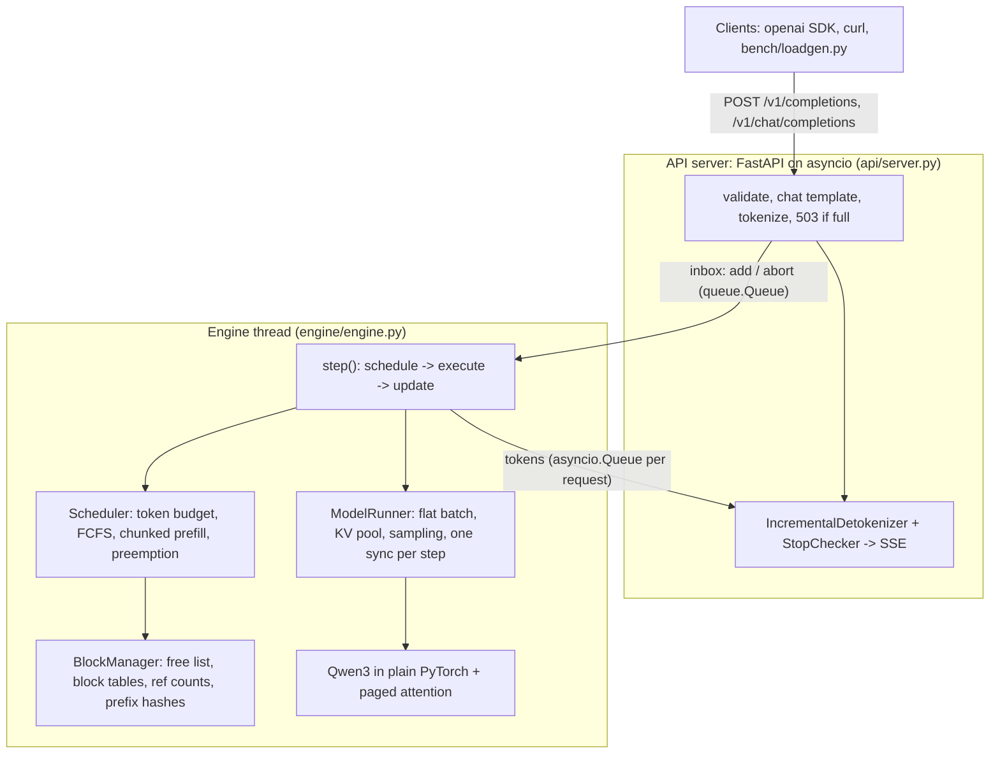

# MiniServe

A small LLM inference server written from scratch in Python and PyTorch. It serves **Qwen3-0.6B** on a
**6 GB RTX 3060 Laptop GPU** through an **OpenAI-compatible streaming API**, and implements the core
ideas of production engines like vLLM: **continuous batching**, a **paged KV cache** with
**preemption**, **prefix caching**, **chunked prefill**, **speculative decoding** (n-gram drafts with
an exact rejection sampler) and **INT8 weight quantization**. Every feature can be switched off and
is measured against a naive Hugging Face baseline that serves one request at a time.

**Measured on the RTX 3060 Laptop GPU:** 565.9 output tokens/s at 64 concurrent streams, **20x** the
Hugging Face baseline's best (27.8 tok/s); paging fits **63 concurrent requests instead of 4** with
fixed 4,096-token slots; prefix caching **halves time to first token** on shared prompts (627 -> 318 ms).

## Architecture



One engine step: the scheduler picks which sequences run and how many tokens each gets (1 for a
decode, a chunk for a prefill); the runner flattens all of them into one batch, runs the model once,
computes logits only for the rows that need them, samples, and syncs with the CPU once; the scheduler
then appends tokens, frees finished sequences' KV blocks and admits new requests next step.

## What's inside

| Feature | Code | How it's tested |
|---|---|---|
| Qwen3 in plain PyTorch (GQA, QK-norm, RoPE, fused QKV and gate/up) | `model/` | Logits equal Hugging Face's on a tiny float64 model, through every attention path |
| Continuous batching with a token-budget scheduler | `engine/scheduler.py` | Batched output == one-at-a-time output; budget and batch-size limits (Hypothesis) |
| Paged KV cache (16-token blocks), recompute preemption | `engine/block_manager.py`, `attention/backends.py` | Block invariants under random operations (Hypothesis); forced-preemption runs match; no leaks |
| Prefix caching (chained block hashes, LRU of freed blocks) | `engine/block_manager.py` | Output identical with the cache on or off; second request computes only its suffix |
| Chunked prefill | `engine/scheduler.py` | Output identical with tiny budgets |
| Speculative decoding: n-gram drafts, greedy and rejection-sampling verification | `spec/` | Greedy output identical with speculation on; chi-square test over 200,000 samples |
| INT8 weight-only quantization (per-row absmax) | `quant/int8.py` | Loads and serves (memory/speed/quality not yet measured) |
| OpenAI API: completions and chat, SSE streaming, usage, stop strings, abort on disconnect, 503 backpressure | `api/` | The official `openai` SDK against a live server |
| Start-up memory profiling to size the KV pool | `runner/model_runner.py` | Pool size logged at start-up: 1,070 blocks = 17,120 tokens on this GPU |
| Naive baseline: HF `generate()`, one request at a time | `baseline/hf_server.py` | Same protocol, same load generator |
| Load generator: TTFT, TPOT, ITL, E2EL, goodput, defined as in `vllm bench serve` | `bench/` | Every run saved as JSON with its environment |

## Results

All numbers below were measured on an **RTX 3060 Laptop GPU (6 GB) under WSL2**, Qwen3-0.6B in BF16,
random 256-token prompts with exactly 128 output tokens, greedy, closed-loop clients streaming over
HTTP. They come from `results/*.json` via `python bench/summarize.py`; `docs/RESULTS.md` has every run.

| System | Clients | Output tok/s | TTFT P50 | TPOT P50 | Concurrent requests (peak) |
|---|---|---|---|---|---|
| HF baseline (one at a time) | 1 | 24.5 | 51 ms | 41.3 ms | 1 |
| HF baseline | 16 | 27.8 | 66.6 s | 35.0 ms | 1 |
| MiniServe | 1 | 15.7 | 65 ms | 56.9 ms | 1 |
| MiniServe | 16 | 220.6 | 320 ms | 65.5 ms | 16 |
| MiniServe | 32 | 420.0 (median of 3) | 440 ms | 72.9 ms | 32 |
| MiniServe | 64 | **565.9** | 1.05 s | 85.1 ms | 63 (154 preemptions) |
| MiniServe, fixed 4,096-token KV slots | 64 | 84.7 | 70.0 s | 46.5 ms | 4 |

Ablations: **paging** vs fixed slots at 64 clients: 565.9 vs 84.7 tok/s (6.7x), 63 vs 4 requests in
flight. **Prefix caching** (1,024-token shared prefix + 128 unique tokens, 16 clients): TTFT P50
318 vs 627 ms, 246 vs 219 tok/s, 102,400 prompt tokens served from cache.

Honest caveats: at **one client the baseline is faster** (24.5 vs 15.7 tok/s), because MiniServe's
decode step is launch-bound (below) and its engine shares a process with the HTTP server. The laptop
GPU ran at 75-84 °C with a varying clock, so runs differ by up to ~±15%; 500 requests per run at 16+
clients, fewer elsewhere.

### What the profiler found

Decode steps are **launch-bound, not bandwidth-bound**. The weights read in 3.73 ms at the measured
318.8 GB/s, but a decode step takes 30-55 ms: `bench/profile_step.py` shows ~1,700 kernel launches
per step at ~28 µs each under WSL2, with the GPU idle much of the time. Continuous batching hides
this (the same launches serve 1 or 64 sequences), and CUDA graphs are the next step.

## Quick start (WSL2 with an NVIDIA GPU)

```bash
bash scripts/setup_wsl.sh                       # uv, CUDA PyTorch, MiniServe, Qwen3-0.6B weights
bash scripts/dev.sh miniserve serve --port 8000 # from PowerShell: .\scripts\wsl.ps1 miniserve serve
```

```bash
curl http://localhost:8000/v1/completions -H "Content-Type: application/json" \
  -d '{"prompt": "The capital of Canada is", "max_tokens": 16, "temperature": 0}'
```

Any OpenAI client works with `base_url="http://localhost:8000/v1"`. Reproduce the benchmarks:

```bash
bash scripts/dev.sh python bench/run_matrix.py --system miniserve --tag ms --concurrency 1 4 16 32 64
bash scripts/dev.sh python bench/run_matrix.py --system hf-baseline --tag hf-baseline --concurrency 1 4 16 --num-prompts 48
bash scripts/dev.sh python bench/summarize.py
```

## Tests

```bash
bash scripts/dev.sh python -m pytest -q          # 60 CPU tests, ~10 s, no GPU or download needed
bash scripts/dev.sh python -m pytest -q -m gpu -s # real model vs Hugging Face, leak test
```

CPU tests run a tiny random Qwen3 in float64, so "batched == alone", "paged == reserved",
"cache on == off" and "speculation on == off" are checked for exact token equality. CI runs lint and
the CPU tests on every push (`.github/workflows/ci.yml`).

## Learn it

- `docs/learn/MiniServe_Textbook.html`: a 21-chapter visual textbook of every idea here, with
  simulators, the code walkthrough, interview questions and flashcards.
- `.tours/architect-request-path.tour`: a CodeTour that follows one request through the code.
- `docs/PLAN.md` (the plan), `docs/design/DESIGN_NOTES.md`, `docs/LEARNING_LOG.md`, `docs/RESULTS.md`.

## Limitations and what's next

- **Launch-bound decode** (above). Next: CUDA graphs for decode steps.
- **Attention gathers K/V** through the block table each step instead of reading pages in place.
  Next: a Triton paged-attention kernel (which also gives CUDA graphs the fixed shapes they need).
- **Engine and HTTP server share one process** and compete for the GIL. Next: a separate engine
  process.
- Not yet measured: speculative decoding (copy-heavy workload), INT8 memory/speed/quality, chunked
  prefill under mixed load, and a head-to-head against vLLM with `vllm bench serve`.
- One model family (dense Qwen3), one GPU, `n = 1`, no logprobs.

## Credits

Built by studying vLLM (Apache-2.0) and nano-vllm (MIT); no code was copied. Papers: PagedAttention
(Kwon et al., SOSP 2023), Orca (Yu et al., OSDI 2022), Sarathi-Serve (Agrawal et al., OSDI 2024),
speculative decoding (Leviathan et al., 2023; Chen et al., 2023), FlashAttention (Dao et al.).
Written with Claude Code as a pair programmer.
