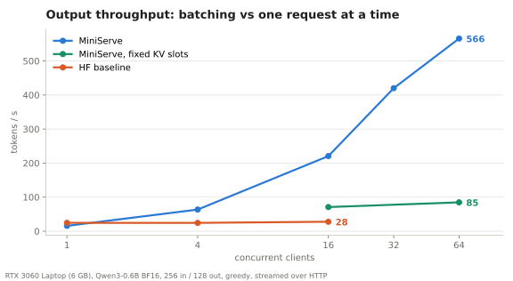
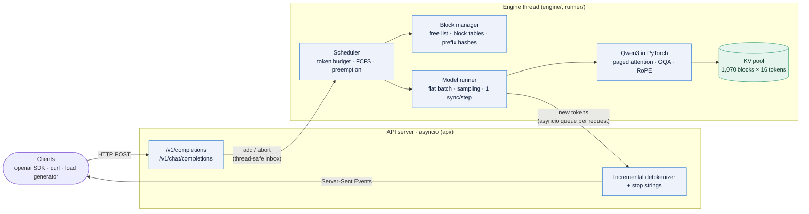
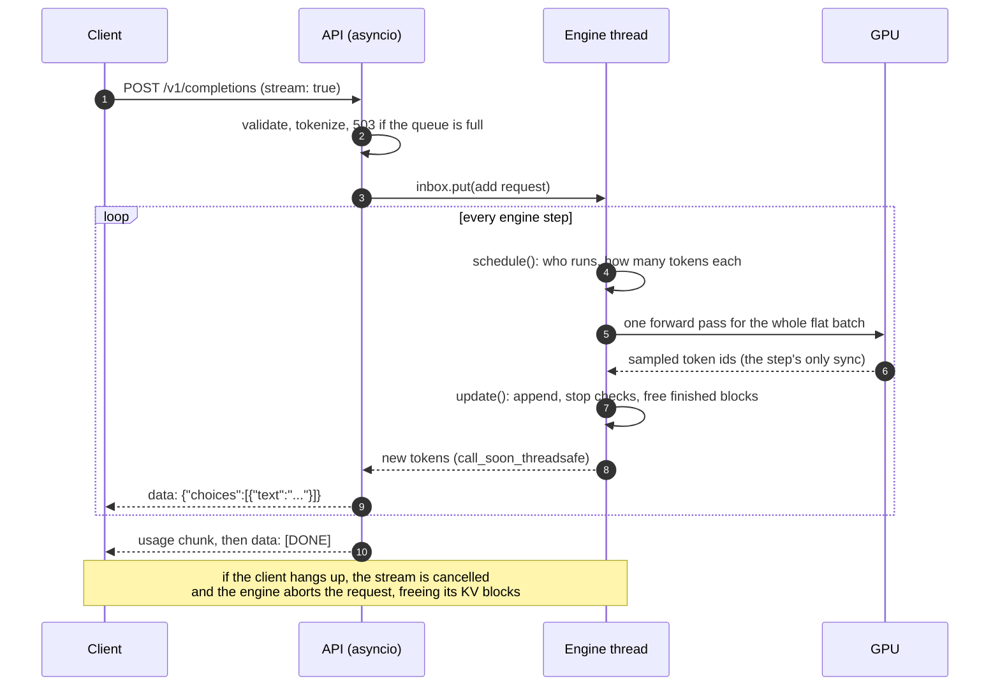
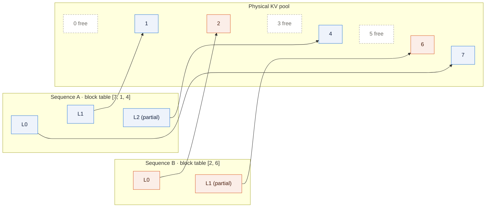
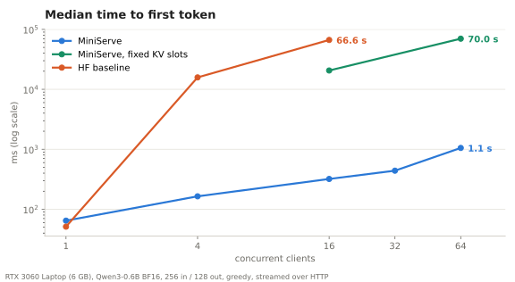
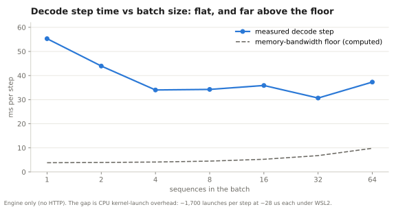

<div align="center">

# MiniServe: an LLM inference server built from scratch

**Continuous batching · paged KV cache · prefix caching · chunked prefill · speculative decoding · OpenAI-compatible streaming**

[](https://github.com/ahrazkk/MiniServe/actions/workflows/ci.yml)


</div>

MiniServe serves **Qwen3-0.6B** on a **6 GB RTX 3060 Laptop GPU**. It's a small version of what
vLLM does, written in plain Python and PyTorch so that every part (the scheduler, the KV-cache
allocator, the model, the attention, the API) is readable and measured. Every optimization can be
switched off, and each one was benchmarked against a naive Hugging Face server that handles one
request at a time.

<table>
<tr>
<td align="center"><h3>566 tok/s</h3>output throughput at 64 streams</td>
<td align="center"><h3>20&times;</h3>the Hugging Face baseline</td>
<td align="center"><h3>4 &rarr; 63</h3>concurrent requests with paging</td>
<td align="center"><h3>2&times;</h3>faster first token with prefix caching</td>
</tr>
</table>

<p align="center"></p>

---

## Contents

[Why this is hard](#why-serving-an-llm-is-hard) · [Architecture](#architecture) ·
[How it works](#how-it-works) · [Results](#results) · [Quick start](#quick-start) ·
[Testing](#how-correctness-is-tested) · [Project layout](#project-layout) · [Roadmap](#limitations-and-roadmap)

## Why serving an LLM is hard

Two numbers explain almost every design decision here:

| | Value | Consequence |
|---|---|---|
| Weights read per decode step | **1.19 GB** (BF16) | At the measured **318.8 GB/s** a step can't beat **3.73 ms**, whether it serves 1 sequence or 64. Batching is nearly free. |
| KV cache per token | **112 KiB** (2 &times; 28 layers &times; 8 KV heads &times; 128 dims &times; 2 B) | Only **17,120 tokens** fit next to the model on 6 GB. Memory, not compute, limits concurrency. |

So the job is: put as many requests in each step as memory allows, waste none of that memory, and
never make users wait behind each other.

## Architecture



The HTTP side never touches the GPU and the engine never touches a socket. They meet in exactly two
places: an inbox of requests and one output queue per request.

<details>
<summary><b>One streamed request, step by step</b></summary>



</details>

## How it works

### Continuous batching

There's no separate prefill phase and decode phase. Every step has a token budget (2,048); each
sequence needs its next N tokens computed: N = 1 while decoding, the rest of the prompt for a new
request. Running sequences go first (oldest first), then waiting requests fill what's left. All of a
step's tokens from all sequences are concatenated into one flat batch, so sequences of any length
share a forward pass with no padding, and a finished sequence's slot is reused at the very next step.

### Paged KV cache

KV memory is a pool of 16-token blocks. Each sequence has a block table, exactly like an OS page
table, and blocks are handed out only when needed.



A token at position *p* lives in slot `block_table[p // 16] * 16 + p % 16`. At most one partly filled
block per sequence is wasted, instead of a whole `max_model_len` reservation. When the pool runs out,
the **newest** running sequence is preempted: its blocks are freed and it's recomputed later (vLLM
V1's policy), with its output so far kept.

### Prefix caching and chunked prefill

Full blocks are hashed together with the previous block's hash, so a hit means the entire prefix
matches. Requests that share a system prompt reuse those blocks instead of recomputing them. Freed
blocks keep their contents in an LRU list until memory is needed. A prompt longer than the step's
remaining budget is split across steps, so a 2,000-token prompt can't freeze everyone else's stream.

### Speculative decoding

An n-gram proposer guesses the next tokens by finding the text's last few tokens earlier in the
context. The model checks all guesses in one forward pass; a rejection sampler accepts each with
probability min(1, p/q) and resamples from max(0, p &minus; q) on rejection, which makes the output
distribution **exactly** the model's own (verified with a chi-square test).

### The rest

- **Qwen3 in plain PyTorch** with grouped-query attention, QK-norm and RoPE; q/k/v and gate/up
  matrices are fused at load time (fewer kernel launches).
- **Attention through block tables**, with GQA done by folding each KV head's two query heads into
  the query dimension, so keys and values are never duplicated.
- **Start-up memory profiling** sizes the KV pool: run a worst-case step, measure the peak, give the
  pool what's left of 80% of the GPU.
- **OpenAI-compatible API**: completions and chat, SSE streaming, usage counts, stop strings,
  emoji-safe incremental detokenization, abort on disconnect, 503 backpressure.
- **INT8 weight-only quantization** (per-row scales), implemented and loading; not yet benchmarked.

## Results

Measured on an **RTX 3060 Laptop GPU (6 GB) under WSL2**, Qwen3-0.6B in BF16, random 256-token
prompts with exactly 128 output tokens, greedy decoding, closed-loop clients streaming over HTTP.
Metrics are defined as in `vllm bench serve`. Every number comes from `results/*.json`
([full tables](docs/RESULTS.md)).

| System | Clients | Output tok/s | TTFT P50 | TPOT P50 | Requests in flight |
|---|---:|---:|---:|---:|---:|
| HF baseline (one at a time) | 1 | 24.5 | 51 ms | 41.3 ms | 1 |
| HF baseline | 16 | 27.8 | 66.6 s | 35.0 ms | 1 |
| MiniServe | 1 | 15.7 | 65 ms | 56.9 ms | 1 |
| MiniServe | 16 | 220.6 | 320 ms | 65.5 ms | 16 |
| MiniServe | 32 | 420.0 *(median of 3)* | 440 ms | 72.9 ms | 32 |
| **MiniServe** | **64** | **565.9** | 1.05 s | 85.1 ms | 63 *(154 preemptions)* |
| MiniServe with fixed 4,096-token KV slots | 64 | 84.7 | 70.0 s | 46.5 ms | 4 |

<p align="center"></p>

**Ablations**

| Change | Workload | Without | With |
|---|---|---:|---:|
| Paged KV vs fixed slots | 64 clients | 84.7 tok/s, 4 in flight | **565.9 tok/s, 63 in flight** |
| Prefix caching | 1,024-token shared prefix, 16 clients | TTFT P50 627 ms, 219 tok/s | **TTFT P50 318 ms, 246 tok/s** |

**Honest caveats.** At *one* client the baseline is faster (24.5 vs 15.7 tok/s): MiniServe's decode
step is launch-bound (below) and its engine shares a process, and Python's GIL, with the HTTP
server. The laptop GPU ran at 75-84 °C with a varying clock, so repeated runs differ by up to ~±15%.

### What the profiler found

<p align="center"></p>

Inside the engine, throughput grows **95&times;** from 1 to 64 sequences (18 &rarr; 1,717 tok/s) while
the step time stays flat, at 30-55 ms against a 4-10 ms bandwidth floor. `bench/profile_step.py`
shows why: about **1,700 kernel launches per step at ~28 µs each** under WSL2, with the GPU idle for
much of the step. The engine is bound by how fast the CPU can launch work, not by the GPU, which is
why CUDA graphs are the next milestone.

## Quick start

Needs an NVIDIA GPU with CUDA and Linux or WSL2 (Windows 11 + Ubuntu 24.04 here).

```bash
bash scripts/setup_wsl.sh                 # uv, CUDA PyTorch, MiniServe, Qwen3-0.6B weights
bash scripts/dev.sh miniserve serve --port 8000
```

Any OpenAI client works:

```python
from openai import OpenAI

client = OpenAI(base_url="http://localhost:8000/v1", api_key="unused")
stream = client.chat.completions.create(
    model="Qwen/Qwen3-0.6B",
    messages=[{"role": "user", "content": "Explain a KV cache in one sentence."}],
    max_tokens=64,
    stream=True,
)
for chunk in stream:
    print(chunk.choices[0].delta.content or "", end="", flush=True)
```

Every optimization is a flag: `--no-prefix-caching`, `--no-chunked-prefill`,
`--kv-reservation full`, `--speculative ngram`, `--quantization int8`, `--max-num-seqs`,
`--max-num-batched-tokens` (`miniserve serve --help` lists them all).

**Reproduce the benchmarks**

```bash
bash scripts/dev.sh python bench/run_matrix.py --system miniserve --tag ms --concurrency 1 4 16 32 64
bash scripts/dev.sh python bench/run_matrix.py --system hf-baseline --tag hf-baseline --concurrency 1 4 16 --num-prompts 48
bash scripts/dev.sh python bench/summarize.py   # tables
bash scripts/dev.sh python bench/plot.py        # the charts above
```

## How correctness is tested

Optimizations must change **how fast** tokens come, never **which** tokens. CI runs everything below
on a CPU in about 10 seconds, using a tiny random Qwen3 in **float64**, where floating-point noise is
too small to flip a token, so equality can be checked exactly.

| Test | What it proves |
|---|---|
| Logits vs Hugging Face | The model matches through fresh prefill, prefill on cached keys, and decode |
| Engine equivalence | Identical greedy output: batched vs alone, paged vs reserved, prefix cache on/off, chunked prefill, forced preemption, speculation |
| Property-based (Hypothesis) | KV blocks never leak or get double-owned under random admit/grow/free sequences |
| Chi-square, 200,000 samples | The speculative-decoding rejection sampler reproduces the target distribution |
| API contract | The official `openai` SDK against a live server: streaming, usage, stop strings, errors, 503, abort on disconnect |
| GPU (local) | Real model: same next token as Hugging Face on 20/20 prompts; no KV leaks after 300 requests with aborts |

## Project layout

```text
src/miniserve/
├── config.py              every engine setting, one flag per optimization
├── engine/
│   ├── sequence.py        a request's tokens, status and block table
│   ├── block_manager.py   paged KV allocator, ref counts, prefix-cache hashes
│   ├── scheduler.py       token-budget continuous batching, chunking, preemption
│   └── engine.py          the step loop + the background engine thread
├── runner/
│   ├── model_runner.py    KV pool, memory profiling, flat batch, the one sync
│   └── sampler.py         greedy / temperature / top-k / top-p, batched
├── model/                 Qwen3 in plain PyTorch, safetensors loader
├── attention/backends.py  paged attention through block tables
├── spec/                  n-gram proposer, rejection sampler
├── quant/int8.py          weight-only INT8
├── api/                   OpenAI-compatible server, detokenizer
└── baseline/              Hugging Face generate() server
bench/                     load generator, sweeps, step timing, profiler, charts
tests/                     unit, property-based, correctness, API, GPU
docs/                      design notes, results, learning log
```

## Limitations and roadmap

- **Launch-bound decode.** Next: CUDA graphs for decode steps.
- **Attention gathers K/V** through the block table every step instead of reading pages in place.
  Next: a Triton paged-attention kernel (which also gives CUDA graphs the fixed shapes they need).
- **Engine and HTTP server share one process** and compete for the GIL. Next: a separate engine process.
- **Not yet measured:** speculative decoding on copy-heavy prompts, INT8 memory/speed/quality,
  chunked prefill under mixed load, and a head-to-head against vLLM using `vllm bench serve`.
- One model family (dense Qwen3), one GPU, `n = 1`, no logprobs.

## Credits

Built by studying [vLLM](https://github.com/vllm-project/vllm) (Apache-2.0) and
[nano-vllm](https://github.com/GeeeekExplorer/nano-vllm) (MIT); no code was copied. Papers:
PagedAttention (Kwon et al., SOSP 2023), Orca (Yu et al., OSDI 2022), Sarathi-Serve (Agrawal et al.,
OSDI 2024), speculative decoding (Leviathan et al., 2023; Chen et al., 2023), FlashAttention
(Dao et al., 2022). Licensed under [MIT](LICENSE).
